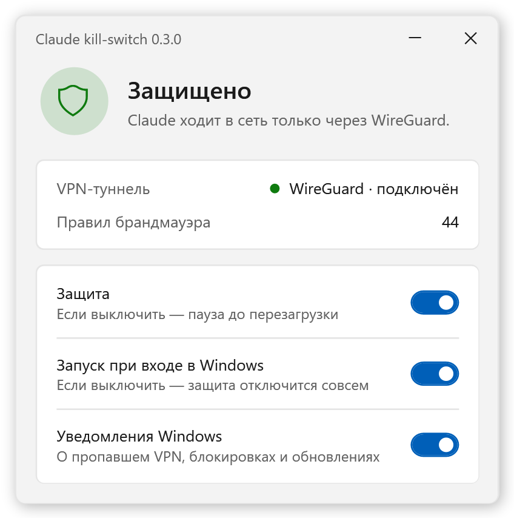

# Claude VPN kill-switch

[](#требования)
[](https://github.com/mrnikitavasilenko-del/claude-vpn-killswitch/releases/latest)
[](LICENSE)

Claude Code и десктопный Claude ходят в сеть **только через VPN**. Если VPN не включён или упал,
запросы Claude не уходят, а Windows показывает уведомление. Браузер и остальные программы не затрагиваются.

> Неофициальный проект, не связан с Anthropic.

<p align="center">
  <picture>
    <source media="(prefers-color-scheme: dark)" srcset=".github/menu-dark.png">
    
  </picture>
</p>

Проект состоит из двух частей:

- **Приложение** — сама защита: правила брандмауэра Windows, фоновый сторож и окно настроек. Нужно обязательно.
- **Плагин для Claude Code** — по желанию. Показывает состояние защиты прямо в Claude Code.
  Сам плагин ничего не блокирует.

## Требования

- Windows 10 или 11.
- Учётная запись администратора: при установке Windows спросит разрешение (окно UAC).
  Защита ставится для того, кто вошёл в Windows и подтвердил это окно.
- VPN-клиент в режиме TUN/VPN, то есть с собственным сетевым адаптером (см. [какие VPN подходят](#какие-vpn-подходят)).
- Десктопный Claude и/или Claude Code.
- Claude Code — в нативной версии, то есть установленный командой с сайта Anthropic.
  Claude Code, установленный через npm (`npm install -g @anthropic-ai/claude-code`), работает как `node.exe`,
  и килл-свитч его не блокирует. Если стоит такая версия, окно настроек предупредит об этом.

## Установка приложения

1. [Скачайте архив](https://github.com/mrnikitavasilenko-del/claude-vpn-killswitch/releases/latest/download/claude-vpn-killswitch.zip) и распакуйте его.
2. Включите VPN.
3. Запустите **`install.cmd`**. Если Windows предупредит о файле из интернета, нажмите «Подробнее» →
   «Выполнить в любом случае» (или «Запустить»). В окне UAC нажмите «Да».

Готово. Защита запускается сама при каждом входе в Windows, а после установки открывается окно настроек.
Ярлык **Claude kill-switch** появится на рабочем столе и в меню «Пуск».

**Обновление.** Раз в сутки приложение проверяет, не вышла ли новая версия. Если вышла, Windows покажет
уведомление, а в окне появится кнопка **Обновить**: она скачает новую версию и установит её сама, без окна UAC.
Можно и вручную: скачать архив и снова запустить `install.cmd`. После обновления защита снова включена:
пауза и выключение сбрасываются, а выключенные уведомления и свои описания VPN сохраняются.

**Удаление.** Запустите **`uninstall.cmd`**.

## Установка плагина для Claude Code

Сначала установите приложение (см. выше). Затем в Claude Code выполните две команды, по очереди.

Добавить магазин плагинов этого проекта:

```
/plugin marketplace add mrnikitavasilenko-del/claude-vpn-killswitch
```

Установить плагин:

```
/plugin install killswitch@claude-vpn-killswitch
```

Приложение можно поставить и из Claude Code: команда `/killswitch install` делает то же самое, что `install.cmd`.

Плагин добавляет:

- **строку над полем ввода** с состоянием защиты: зелёная «Защищено» и имя VPN-адаптера, через который идёт Claude;
  красная «Claude заблокирован», когда VPN не подключён; жёлтая «Защита на паузе». Обновляется раз в 30 с;
- **команду `/killswitch`**: `status` (по умолчанию) — состояние, `menu` — окно настроек,
  `install` — установить или переустановить приложение. Команда отвечает сама, без запроса к модели,
  поэтому работает и без VPN, когда Claude заблокирован.

Выключить защиту или поставить её на паузу можно только переключателями в окне настроек — у команды `/killswitch`
такой возможности нет. Так защиту не выключить случайно, набрав команду в чате.

**Обновление.** Чтобы плагин обновлялся сам, включите автообновление магазина: команда `/plugin`,
вкладка Marketplaces, `claude-vpn-killswitch`, пункт **Turn on auto-update**. Вручную: `claude plugin update killswitch`.

**Удаление.** `claude plugin uninstall killswitch`. Приложение при этом остаётся и продолжает защищать.

## Окно настроек

Открывается ярлыком **Claude kill-switch**. Светлая или тёмная тема — как в Windows.

Сверху — состояние защиты:

| Состояние | Что значит |
|---|---|
| **Защищено** | VPN подключён, Claude ходит в сеть только через него |
| **Claude заблокирован** | VPN не подключён, Claude в сеть не ходит. Включите VPN |
| **Защита на паузе** | до перезагрузки Claude ходит в сеть без VPN |
| **Защита выключена** | Claude ходит в сеть без VPN, пока не включить «Запуск при входе в Windows» |
| **Claude не найден** | Claude ещё не установлен — защита включится сама, когда он появится |
| **Сторож не запущен**, **Защита не работает** | что-то сломалось: перезагрузите компьютер или переустановите приложение |
| **Килл-свитч не установлен** | окно открыто из плагина, а приложение не установлено |

Ниже:

- **VPN-туннель** — найденный адаптер VPN и подключён ли он;
- **Правил брандмауэра** — сколько правил блокировки сейчас действует (по два на каждую программу Claude);
- **Защита** — если выключить, Claude ходит без VPN до перезагрузки;
- **Запуск при входе в Windows** — если выключить, защита отключается совсем, пока его не вернуть;
- **Уведомления Windows** — «VPN не включён», «Запрос Claude заблокирован» и «Доступно обновление»;
- когда вышла новая версия — строка **Доступна версия …** с кнопкой **Обновить**.

Переключатели работают без прав администратора.

## Какие VPN подходят

Любой, который создаёт сетевой адаптер (режим TUN/VPN). VPN узнаётся по описанию адаптера.

- Проверено: **Happ**, **WireGuard**, **AmneziaVPN**.
- Должны работать, но не проверялись: OpenVPN, Outline, v2rayN, Hiddify, sing-box в режиме TUN,
  Cisco AnyConnect, FortiClient.
- Не подходят: режим «системный прокси» (без адаптера) — включите в клиенте режим TUN;
  встроенный VPN Windows (IKEv2, L2TP, SSTP, PPTP) — через него Claude будет заблокирован.

## Если Claude не работает при включённом VPN

Откройте окно настроек и посмотрите строку **VPN-туннель**.

- **«не найден»** — килл-свитч не узнал ваш VPN, поэтому блокирует Claude. Узнайте описание адаптера:
  в PowerShell выполните `Get-NetAdapter | ft Name, InterfaceDescription` и найдите строку вашего VPN.
  Откройте Блокнот от имени администратора, откройте в нём файл
  `C:\Program Files\ClaudeKillSwitch\vpn-adapters.txt` и допишите описание адаптера отдельной строкой —
  целиком, в точности как в выводе команды. Через 5 секунд Claude заработает. Обновления этот файл не трогают.
  Если не хочется возиться — [откройте issue](https://github.com/mrnikitavasilenko-del/claude-vpn-killswitch/issues)
  с названием VPN-клиента и описанием адаптера, добавим в следующую версию.
- **«отключён»**, хотя VPN включён, — через VPN не идёт весь интернет (раздельное туннелирование).
  Включите в клиенте режим, при котором через VPN идёт весь трафик.

## Если антивирус ругается

Вредоносного кода здесь нет, весь код открыт и лежит в `windows\`. Но килл-свитч — это PowerShell-скрипт:
он запускается с `-ExecutionPolicy Bypass`, меняет правила брандмауэра, читает журнал безопасности
и умеет скачать обновление с GitHub. Вредоносные программы делают похожее, поэтому поведенческие модули
антивирусов иногда отправляют скрипт в карантин (у Avast это выглядит как `IDP.Generic`).
Такое возможно у Avast, AVG, Norton, Avira, Bitdefender, Kaspersky, ESET и Защитника Windows. Срабатывает
не всегда и не на всех компьютерах.

1. Верните файл из карантина. Если антивирус его удалил, переустановите: `install.cmd` или `/killswitch install`.
2. Добавьте в исключения антивируса три папки:
   - `%USERPROFILE%\.claude\plugins\cache\claude-vpn-killswitch`
   - `%USERPROFILE%\.claude\plugins\marketplaces\claude-vpn-killswitch`
   - `C:\Program Files\ClaudeKillSwitch`

   В Avast: **Меню → Настройки → Общие → Исключения → Добавить исключение**.
3. По желанию сообщите антивирусу о ложном срабатывании, например через
   [форму Avast](https://www.avast.com/false-positive-file-form.php).

## Как работает

- Брандмауэр Windows запрещает каждому exe Claude исходящий трафик на всех сетевых адаптерах, кроме VPN,
  и на всех подключениях удалённого доступа (PPPoE, встроенный VPN Windows).
  Через VPN трафик проходит, напрямую — нет. Защита работает, даже если VPN-клиент упал или не запущен.
- Фоновый сторож (задача планировщика при входе в Windows) раз в 5 с:
  - пересоздаёт правила, если Claude обновился (у десктопа меняется папка `app-<версия>`)
    или появился новый сетевой адаптер (например, раздача интернета с телефона);
  - показывает уведомление «VPN не включён», если Claude запущен, а VPN нет;
  - показывает уведомление «Запрос Claude заблокирован» с адресом, куда Claude пытался выйти
    (не чаще раза в минуту — Claude Code повторяет запрос до 10 раз).
    О мультикасте и широковещании (например, mDNS `224.0.0.251`, которым Chromium в десктопе ищет устройства
    в локальной сети) не уведомляет: они не выходят за пределы локальной сети и в туннель уйти не могут,
    но блокируются так же.
    Для этого установщик включает аудит блокировок брандмауэра (событие 5157 в журнале безопасности).
- Под защитой: нативный Claude Code (`~\.local\bin\claude.exe` и его версии), десктопный Claude
  (`%LOCALAPPDATA%\AnthropicClaude`), встроенный в десктоп Claude Code (вкладка Code)
  и десктоп из Microsoft Store.
- Раз в сутки сторож спрашивает у GitHub номер последнего релиза. Обновление ставит отдельная задача планировщика
  «Claude kill-switch update» с правами администратора — только по кнопке **Обновить** и только последний релиз
  отсюда. Архив скачивается в `Program Files`, куда обычные программы писать не могут, — подменить его по дороге нельзя.

## Проверка

1. Запустите Claude и выключите VPN → уведомление «VPN не включён», в окне — «Claude заблокирован».
2. `claude -p "ping"` → уведомление «Запрос Claude заблокирован», а в конце
   `API Error: Connection refused — a firewall or proxy may be blocking it`. Браузер при этом работает.
   Ответ `403` или `Request not allowed` означал бы, что запрос дошёл до Anthropic, — защита не сработала.
3. Включите VPN → `claude` снова отвечает.

Журнал блокировок (PowerShell от администратора):
`Get-WinEvent -FilterHashtable @{LogName='Security'; Id=5157} | ? { $_.Properties[1].Value -match 'claude' }`

Список правил (PowerShell от администратора): `Get-NetFirewallRule -Group 'Claude kill-switch'`.

## Ограничения

- **Маршрутизация VPN-клиента.** Если в клиенте для Anthropic стоит правило «напрямую», трафик уйдёт мимо VPN
  от имени самого клиента, и брандмауэр его не увидит. `anthropic.com` и `claude.ai` должны идти через VPN.
- **Claude Code через npm** работает как `node.exe` и не блокируется. Окно настроек предупредит об этом.
  Поставьте нативную версию.
- **Дочерние процессы** (`git`, `node`, `curl`, MCP-серверы), которые запускает Claude, не блокируются.
- **Cowork** работает в виртуальной машине Hyper-V, его трафик идёт не от `claude.exe`.
- **Выключатель без UAC.** Флаги паузы и выключения лежат в `%LOCALAPPDATA%`, их может поставить любая программа
  от имени пользователя, в том числе сам Claude Code через терминал. Это защита от случайной утечки,
  а не от программы, которая хочет обойти её намеренно.
- **Новый адаптер** (например, раздача с телефона) закрывается не мгновенно, а в течение 5 секунд.
- **DNS** обслуживает система: если DNS идёт мимо VPN, провайдер увидит имя `api.anthropic.com`.
- Защищается только пользователь, который ставил приложение.
- **Аудит блокировок** пишет в журнал безопасности все блокировки брандмауэра на компьютере, не только Claude:
  журнал заполняется быстрее. `uninstall.cmd` выключает аудит обратно (даже если он был включён до установки).

## Что в репозитории

- `install.cmd`, `uninstall.cmd` — установить и удалить приложение. Внутри только запуск `windows\install.ps1`:
  файл `.ps1` по двойному щелчку открывается в Блокноте, а не выполняется.
- `windows\install.ps1` — установщик: копирует приложение в `Program Files\ClaudeKillSwitch`, создаёт задачу
  автозапуска и ярлыки, включает аудит блокировок. С `-Uninstall` убирает всё обратно.
- `windows\killswitch.ps1` — само приложение: фоновый сторож с правилами брандмауэра, окно настроек,
  проверка обновлений. `windows\icon.ico` — его значок.
- `.claude-plugin\`, `hooks\`, `types\` — плагин для Claude Code.
- `.github` — скриншоты для этой страницы и правила сообщений об уязвимостях (`SECURITY.md`).

## Лицензия

[MIT](LICENSE)
